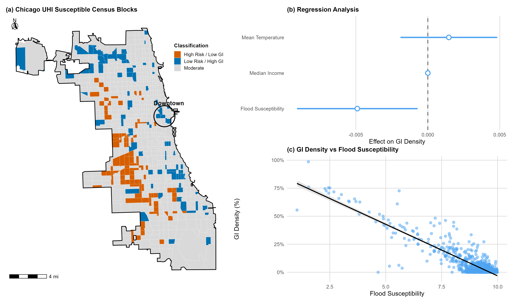

# James Moran | GIS & Environmental Data Portfolio

I use GIS, R, and field monitoring data to study environmental change and communicate findings through maps, figures, and research presentations. My graduate work in Forest Resources and Conservation at the University of Florida focuses on geospatial analysis and applied conservation.

[Résumé (PDF)](files/James-Moran-Resume.pdf) · [LinkedIn](https://www.linkedin.com/in/james-moran-/)

## Selected projects

| Project | What I did | Skills |
| --- | --- | --- |
| [Chicago green infrastructure, urban heat, and flood risk](projects/chicago-gi.md) | Combined census, infrastructure, and environmental data to compare green infrastructure availability with heat and flood susceptibility across Chicago census blocks. | R, spatial joins, raster analysis, regression |
| [Brazilian peppertree monitoring in Florida](projects/brazilian-peppertree.md) | Turned field monitoring records into maps of site visits, thrips detections, and county-level releases. | R, GIS, spatial data cleaning, ecological monitoring |
| [Soil health and sustainable agriculture](projects/soil-health.md) | Supported USDA SARE research through soil and compost sampling, field plot maintenance, and grower outreach. | Field research, sample collection, research communication |
| [Invasive aquatic plants and eutrophication](projects/aquatic-restoration.md) | Compared published case studies and summarized restoration strategies in an academic presentation. | Literature synthesis, aquatic ecology, science communication |

## Featured figure

The Chicago analysis pairs a census-block map with regression and scatterplot outputs to show how green infrastructure relates to environmental and socioeconomic variables. [Read the Chicago case study](projects/chicago-gi.md).

## Technical skills

- **GIS and spatial analysis** — ArcGIS Pro, ArcGIS Online, StoryMaps, `sf`, `terra`, spatial joins, and raster and vector workflows.
- **Programming and statistics** — R, RStudio, tidyverse, ggplot2, JMP, Excel, regression, ANOVA, and experimental design.
- **Environmental research** — Ecological monitoring, invasive species, soil health, field sampling, and conservation outreach.

## Quarto source

This repository also includes the original RStudio and Quarto project. To preview it, open [James Portfolio Website.Rproj](James%20Portfolio%20Website.Rproj) in RStudio or run `quarto preview` from the repository root. Run `quarto render` to rebuild the site in [`docs/`](docs/).
