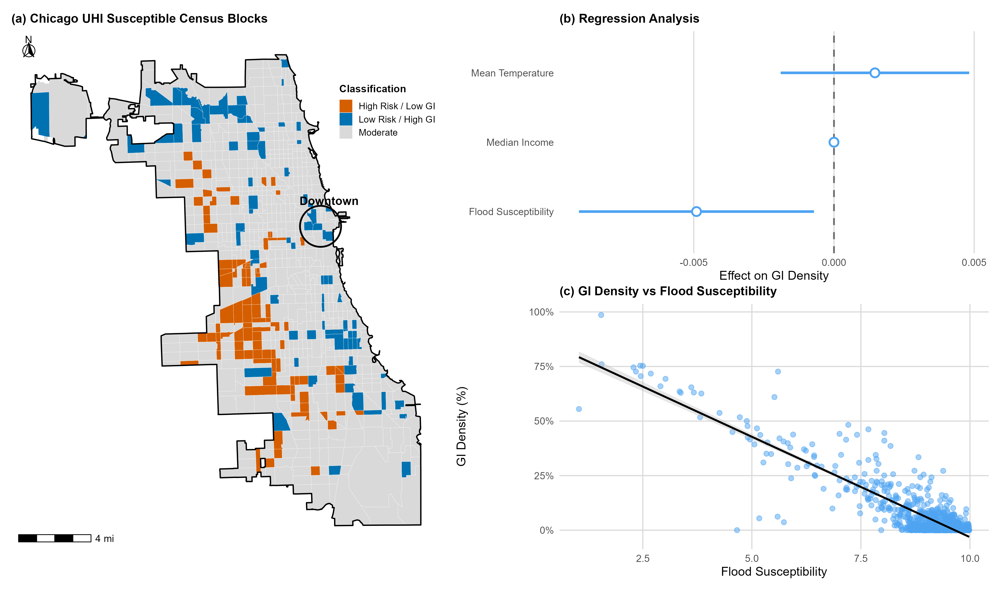

I’m a graduate student studying how invasive species, land use, and climate affect ecosystems. I use GIS, R, and field monitoring data to map those changes and inform conservation planning.

## Featured projects

::: {.project-card}
### Green infrastructure, urban heat, and flooding in Chicago

{fig-alt="Map of Chicago showing green infrastructure and environmental risk, alongside regression results and a scatterplot."}

Where does a city need more green space? I compared green infrastructure, temperature, flood susceptibility, and median income across Chicago census tracts to identify areas for further investment.

[Explore the Chicago analysis](projects/chicago-gi.qmd){.project-button}
:::

::: {.project-card}
### Mapping Brazilian peppertree biological control in Florida

I mapped thrips releases and follow-up field observations to track where crews released biological control agents and where they later detected them.

[Open the county release map](assets/Maps/total-thrips-released-by-county.html){.project-button} [View the project](projects/brazilian-peppertree.qmd)
:::

::: {.project-card}
### Soil health and sustainable agriculture

In a USDA SARE research project, I helped test seed viability, set up field plots, and extract DNA from soil and compost to study beneficial microorganisms in agricultural soils.

[Explore the soil health research](projects/soil-health.qmd){.project-button}
:::

::: {.project-card}
### Eutrophication and invasive aquatic plants

My presentation examines how nutrient enrichment and invasive plants affect freshwater ecosystems, using hydrilla, water lettuce, and water hyacinth as case studies.

[Open the presentation (PDF)](files/P2P.pdf){.project-button} [Read the research summary](projects/P2P.qmd)
:::

## Applied statistics

My R and JMP work includes regression, ANOVA, and model interpretation. The [Chicago analysis](projects/chicago-gi.qmd) shows how I use regression alongside maps to interpret environmental data.

## Contact

[Get in touch](contact.qmd) or [view my résumé](projects/resume.qmd).
