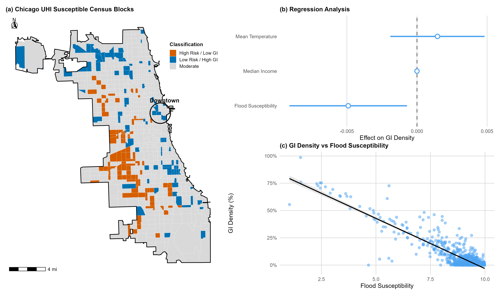

# Chicago Green Infrastructure, Urban Heat, and Flood Risk

**Question** — How does green infrastructure availability vary across Chicago census blocks in relation to heat, flood susceptibility, and median income?

## What I did

- Joined census income data to block boundaries and aligned spatial layers to a common coordinate reference system.
- Combined and rasterized green infrastructure layers, calculated coverage density by block, and extracted temperature and flood susceptibility values.
- Classified blocks by environmental risk and green infrastructure availability, then used regression and visualizations to examine relationships with temperature, median income, and flood susceptibility.

## Selected output

The classification highlights blocks with high environmental risk and low green infrastructure availability. These areas can help focus follow-up planning for shade and stormwater improvements.

**Tools** — R, `sf`, `terra`, tidyverse, ggplot2, patchwork, and ggspatial.

[View the workflow diagram](../assets/images/methodology.png) · [Quarto source](chicago-gi.qmd) · [Portfolio home](../README.md)
