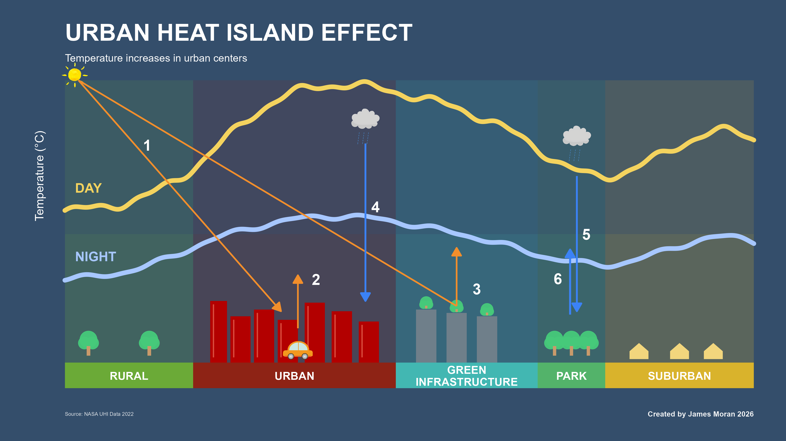
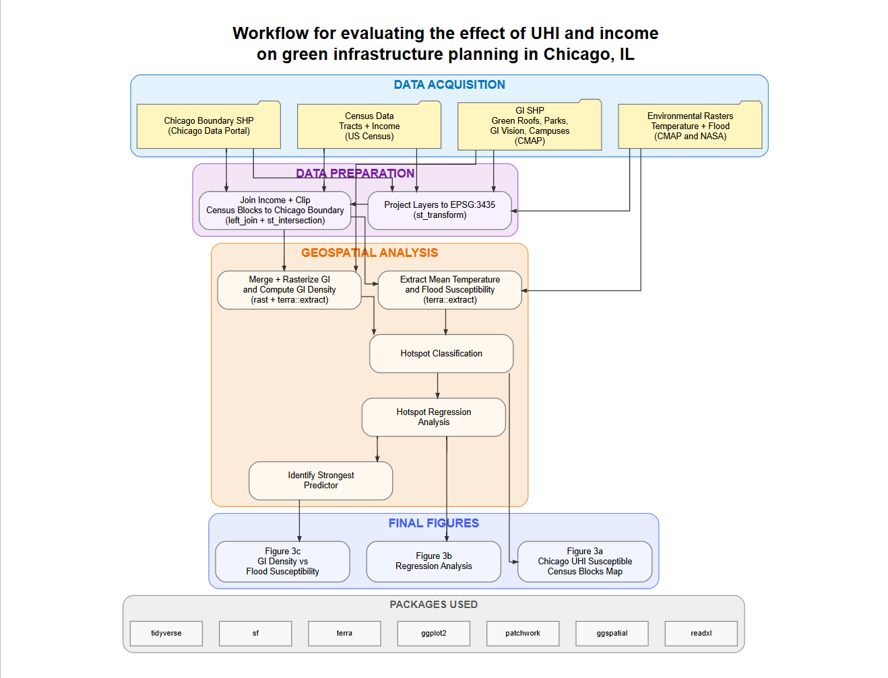
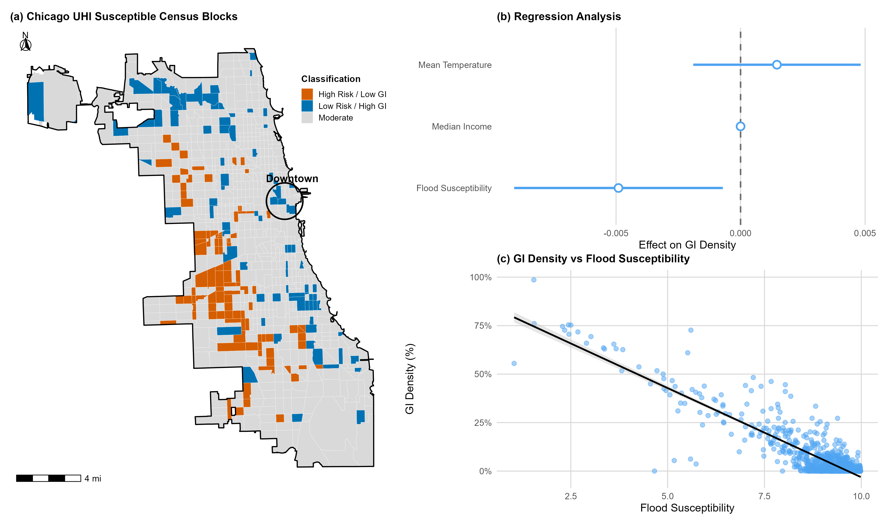

## Overview

This project evaluated how green infrastructure is distributed across Chicago, Illinois in relation to urban heat, flood susceptibility, and median income. The goal was to identify areas where green infrastructure is already well established and areas where additional planning attention may be needed due to higher environmental or socioeconomic vulnerability.

Urban areas often experience increased temperatures and flooding because of impervious surfaces, dense development, roads, rooftops, and heavy vehicle use. Green infrastructure such as parks, green roofs, neighborhood gardens, natural areas, wildlife areas, and canopy coverage can help reduce local temperatures, absorb stormwater, reduce runoff, and improve urban resilience.

## Research Question

Does temperature, flood risk, and median income influence where green infrastructure is placed in Chicago, Illinois?

## Project Objectives

-   Identify existing green infrastructure across Chicago, including parks, green roofs, neighborhood gardens, wildlife areas, natural areas, and canopy coverage.
-   Determine census blocks with high and low green infrastructure density.
-   Compare green infrastructure distribution with temperature, flood susceptibility, and median income.
-   Identify areas with high environmental risk and low green infrastructure availability.
-   Use spatial and statistical analysis to support climate-resilient and equity-focused urban planning.

## Tools Used

-   RStudio
-   R
-   tidyverse
-   sf
-   terra
-   ggplot2
-   patchwork
-   ggspatial
-   readxl
-   Census data
-   Chicago spatial boundary data
-   Green infrastructure shapefiles
-   Temperature and flood susceptibility raster data

## Data Sources

This project combined multiple spatial and tabular datasets, including Chicago boundary data, census tract and income data, green infrastructure shapefiles, and environmental raster datasets for temperature and flood susceptibility.

## Methods

The workflow moved from data acquisition and preparation into geospatial analysis, hotspot classification, regression analysis, and final figure production.

Key steps included:

-   Joined census income data to Chicago census block boundaries.
-   Projected spatial layers into a common coordinate reference system.
-   Merged and rasterized green infrastructure layers.
-   Computed green infrastructure density for census blocks.
-   Extracted mean temperature and flood susceptibility values from raster datasets.
-   Classified census blocks by environmental risk and green infrastructure availability.
-   Modeled relationships between green infrastructure density, mean temperature, median income, and flood susceptibility.
-   Created final map, regression coefficient figure, and scatterplot outputs.

## Conceptual Background

Urban heat island effects occur when built surfaces such as concrete, asphalt, rooftops, and large buildings absorb and retain heat. In contrast, vegetation and green infrastructure can reduce heat storage through shade, evapotranspiration, stormwater uptake, and reduced runoff.

## Workflow Diagram

The project workflow included data acquisition, data preparation, geospatial analysis in RStudio, hotspot classification, regression analysis, and final map/figure outputs.

## Selected Outputs

### Chicago Census Block Green Infrastructure Analysis

This figure shows census blocks classified by combined environmental risk and green infrastructure availability. It highlights areas with high risk and low green infrastructure, low risk and high green infrastructure, and moderate conditions.

### Regression and Flood Susceptibility Analysis

The regression output examined relationships between green infrastructure density and mean temperature, median income, and flood susceptibility. The scatterplot visualized the relationship between green infrastructure density and flood susceptibility across census blocks.

## Skills Demonstrated

-   Environmental data analysis
-   R-based geospatial analysis
-   Raster and vector workflows
-   Census data integration
-   Spatial joins
-   Raster extraction
-   Green infrastructure density analysis
-   Hotspot classification
-   Regression analysis
-   Data visualization
-   Map production
-   Climate resilience planning
-   Environmental justice analysis
-   Technical communication

## Why This Matters

This project demonstrates my ability to combine environmental datasets, census information, raster data, and green infrastructure records to evaluate climate and socioeconomic vulnerability. The analysis connects spatial data science with real-world planning questions related to urban heat, flooding, infrastructure equity, and climate resilience.

By identifying areas with high environmental risk and low green infrastructure availability, this type of analysis can help planners prioritize neighborhoods where additional trees, parks, green roofs, gardens, or natural areas may provide the greatest benefit.
